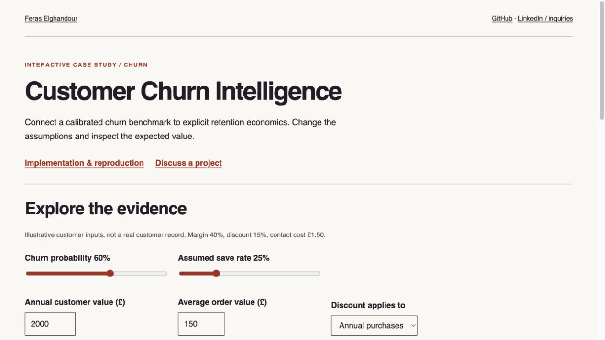

# Customer Churn Intelligence

**Feras Elghandour**

Connect customer churn probabilities to explicit retention economics, including discount cost, customer value, and an uncertain treatment-response assumption.

**[Explore the interactive calculator](https://feraselghandour.github.io/customer-churn-intelligence/)** · [Model evidence](artifacts/metrics.json) · [Economic assumptions](artifacts/decision_metrics.json) · [Operating scope](OPERATIONS.md)

[](https://feraselghandour.github.io/customer-churn-intelligence/)

## Problem and implementation

In non-contractual retail, churn is a definition derived from purchase inactivity. This project constructs a 90-day inactivity label, builds RFM/cadence/trend features, compares classifiers, and applies a per-customer expected-value decision model.

The saved comparison favors logistic regression for simplicity: candidate AUC differences have bootstrap intervals spanning zero. Retention policy economics include the discount given to customers who would have stayed without intervention.

## Evidence and interpretation

| Measure | Recorded result |
|---|---:|
| Evaluated customers | 1,077 |
| Logistic ROC-AUC / Brier score | 0.763 / 0.1965 |
| Modeled historical revenue exposure | £1.75m |
| Modeled value at risk in the proposed contact list | £1.14m |
| Scenario net, next-order discount | +£1,841 |
| Scenario net, annual discount | −£858 |

The two net values depend on an **assumed 25% save rate**, 40% margin, 15% discount, and £1.50 contact cost. They are modeled scenarios, not measured campaign profit. The contact-list exposure is not revenue saved or protected. Neither the dataset nor test labels observe a retention treatment. Model/policy comparisons on the historical cohort are exploratory; the selected policy needs prospective validation.

## Interactive demonstration

Change churn probability, customer value, order value, assumed save rate, and offer scope. The calculator recomputes the same expected-value equation used by the Python decision layer, showing retained margin, unnecessary discounts, contact cost, and expected net separately. Inputs are illustrative and never transmitted.

## Reproduce

```sh
python -m venv .venv
. .venv/bin/activate
python -m pip install -r requirements.txt
python run.py
```

The original pipeline requires its attributed transaction input; see `src/data.py` for the expected location and preprocessing. The public report can be rebuilt from retained aggregate records with `python build_report.py`, without downloading customer transactions. `python -m unittest discover -s tests` checks the economic decision calculation against independently specified scenarios.

## Practical relevance and operating limits

Useful for evaluating which customers could justify intervention and how offer design changes the economics. A production campaign requires an independently evaluated probability model, measured incremental treatment response from a randomized holdout, consent and suppression controls, data contracts, monitored delivery, and human approval. This public demonstration sends no messages and claims no client revenue result.

[Portfolio](https://feraselghandour.github.io/) · [Professional inquiries](https://www.linkedin.com/in/feras-elghandour/)
